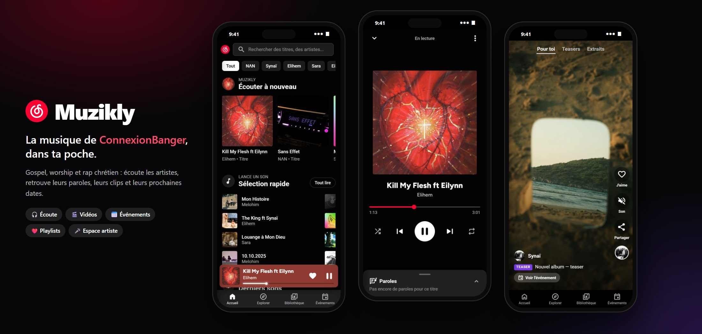
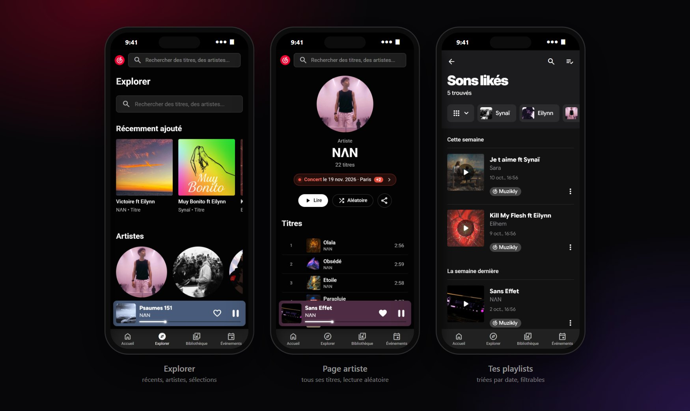
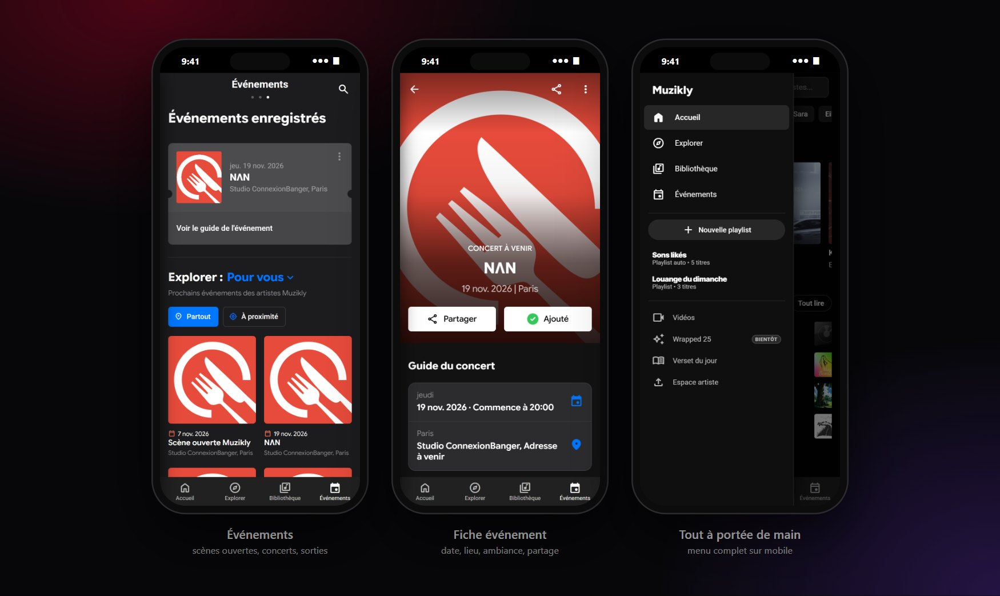
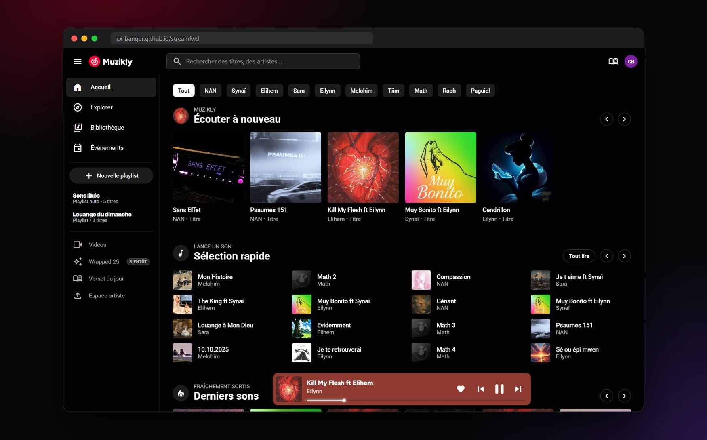
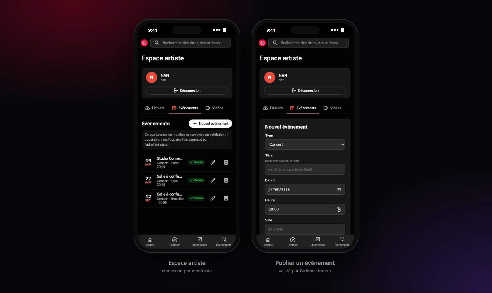

<div align="center">

<a href="https://cx-banger.github.io/streamfwd/">
  
</a>

<h1>Muzikly</h1>

<p><strong>La musique de ConnexionBanger, dans ta poche.</strong><br>
Gospel, worship et rap chrétien : écoute les artistes, retrouve leurs paroles,<br>leurs clips et leurs prochaines dates.</p>

<p>
  <a href="https://cx-banger.github.io/streamfwd/"></a>
  &nbsp;
  <a href="https://cx-banger.github.io/streamfwd/#/videos"></a>
  &nbsp;
  <a href="https://cx-banger.github.io/streamfwd/#/upcoming"></a>
</p>

<p>
  
  
  
</p>

</div>

---

## 👋 En deux mots

**Muzikly** est l’application d’écoute des artistes du collectif **ConnexionBanger**.
Elle s’ouvre directement dans ton navigateur, **sur téléphone comme sur ordinateur** — rien à installer, aucun compte à créer pour écouter.

<table>
<tr>
<td width="33%" valign="top">

### 🎧 Écouter
Tous les titres des 10 artistes, la recherche, les paroles, tes sons likés et tes playlists.

</td>
<td width="33%" valign="top">

### 🎬 Regarder
Clips, teasers, extraits et lives dans un fil vertical, comme sur Reels ou TikTok.

</td>
<td width="33%" valign="top">

### 📅 Ne rien manquer
Scènes ouvertes, concerts et nouvelles sorties, avec rappel dans ton agenda.

</td>
</tr>
</table>

<div align="center">

**[▶️ Essayer maintenant — cx-banger.github.io/streamfwd](https://cx-banger.github.io/streamfwd/)**

</div>

---

## 🎧 Écouter



- **Accueil** : reprends là où tu t’étais arrêté, découvre la *Sélection rapide* du jour et les derniers sons.
- **Explorer** : cherche un titre ou un artiste — même sans les accents (« genant » trouve « Génant »).
- **Pages artistes** : tous leurs titres, lecture d’un coup ou en aléatoire, et leur prochain événement.
- **Sons likés & playlists** : touche ♡ pour garder un titre, crée tes playlists, filtre-les par artiste.
- **Lecteur** : pochette en grand, paroles, vidéo animée quand elle existe, mini-lecteur aux couleurs de la pochette.
- **Partage** : chaque titre, artiste, vidéo et événement a son propre lien à envoyer à tes proches.

## 🎬 Vidéos & 📅 Événements



- **Vidéos** : un fil vertical plein écran — fais glisser pour passer à la suivante, ♡ pour aimer, 🎵 pour écouter le titre.
- **Événements** : scènes ouvertes, concerts et sorties d’albums, filtrables *Partout* ou *À proximité* de toi.
- **Fiche d’un événement** : date, lieu (ouvre la carte), ajout à ton agenda, teaser, et la playlist de l’artiste pour te mettre dans l’ambiance.
- **« Ajouter »** : garde tes événements préférés en haut de la page Événements.

## 💻 Aussi sur ordinateur



Sur grand écran, Muzikly prend la forme d’une vraie appli de streaming : barre latérale, lecteur en bas, paroles à côté de la pochette, et raccourcis vers tes playlists.

---

## 🎤 Pour les artistes



Chaque artiste de ConnexionBanger dispose d’un **Espace artiste** (menu → *Espace artiste*) pour :

| | |
|---|---|
| ☁️ **Envoyer ses fichiers** | sons (MP3, WAV…), pochettes (JPG, PNG) et vidéos (MP4) — 50 Mo max, glisser-déposer |
| 📅 **Publier ses événements** | concerts, scènes ouvertes, sorties : date, lieu, affiche, lien billetterie |
| 🎬 **Publier ses vidéos** | clips, teasers, extraits, lives — un fichier envoyé ou un lien YouTube |

**Comment se connecter ?** Avec l’**identifiant** et le **mot de passe** fournis par ConnexionBanger (pas besoin d’e-mail).
**Mot de passe oublié ?** Demande à l’administrateur, il le réinitialise.

> 🔒 Chaque artiste ne peut gérer **que son propre contenu**. Tout ce qu’il publie est **vérifié par l’administrateur** avant d’apparaître dans l’app.

## 🛡️ Pour l’administrateur

- L’onglet **Validation** de l’Espace artiste liste tout ce qui attend ton feu vert : **Publier** ou **Refuser** en un clic.
- Tu peux publier toi-même pour n’importe quel artiste, ou pour le collectif (*ConnexionBanger*).
- Création des comptes, règles de sécurité et réinitialisation des mots de passe : tout est expliqué pas à pas dans **[supabase/espace-artiste/LISEZ-MOI.md](supabase/espace-artiste/LISEZ-MOI.md)**.

---

## ❓ Questions fréquentes

<details>
<summary><strong>Est-ce gratuit ? Faut-il un compte pour écouter ?</strong></summary>

Oui, c’est gratuit et sans publicité. Aucun compte n’est nécessaire pour écouter : tes likes et tes playlists sont gardés sur ton appareil.
</details>

<details>
<summary><strong>Comment l’avoir comme une appli sur mon téléphone ?</strong></summary>

Ouvre [le site](https://cx-banger.github.io/streamfwd/) puis :
- **iPhone (Safari)** : bouton *Partager* → *Sur l’écran d’accueil* ;
- **Android (Chrome)** : menu ⋮ → *Ajouter à l’écran d’accueil*.

Muzikly s’ouvre alors en plein écran, comme une application.
</details>

<details>
<summary><strong>Pourquoi les vidéos démarrent-elles sans le son ?</strong></summary>

Les navigateurs n’autorisent la lecture automatique qu’en sourdine. Touche le bouton 🔇 *Son* à droite de la vidéo pour l’activer.
</details>

<details>
<summary><strong>« À proximité » ne montre rien ?</strong></summary>

Autorise l’accès à ta position quand le navigateur te le demande. Seuls les événements à moins de 100 km sont affichés.
</details>

<details>
<summary><strong>Je suis artiste et je veux rejoindre Muzikly</strong></summary>

Contacte ConnexionBanger : l’administrateur crée ton Espace artiste et te transmet ton identifiant.
</details>

---

## 🛠️ Pour les développeurs

<details>
<summary><strong>Lancer le projet en local</strong></summary>

Prérequis : [Node.js](https://nodejs.org) 18 ou plus.

```bash
npm ci          # installe les dépendances
npm run dev     # http://localhost:5173/streamfwd/
```

Pour les données du projet Supabase principal, crée un fichier `.env` (non versionné) :

```
VITE_SUPABASE_URL=https://<projet>.supabase.co
VITE_SUPABASE_ANON_KEY=<clé anon>
```
</details>

<details>
<summary><strong>Publier une nouvelle version</strong></summary>

Le site est servi par **GitHub Pages** depuis le dossier `docs/`.

```bash
npm run build   # reconstruit docs/ à partir de index.html, src/ et public/
git add -A && git commit -m "…" && git push
```

> ⚠️ Ne modifie jamais `docs/` à la main : il est entièrement régénéré à chaque `npm run build`.
</details>

<details>
<summary><strong>Organisation du code</strong></summary>

| Chemin | Rôle |
|---|---|
| `index.html` | Structure de l’app (pages, lecteurs, navigation) |
| `src/script.js` | Catalogue, navigation par URL (`#/…`), pages, recherche, likes |
| `src/player.js` | Mini-lecteur, lecteur plein écran, paroles, vidéos animées |
| `src/playlistView.js` | Écrans *Sons likés* et playlists |
| `src/events.js` · `src/eventsData.js` | Page Événements (+ données de secours) |
| `src/videos.js` · `src/videosData.js` | Fil vertical des vidéos (+ données de secours) |
| `src/liveData.js` | Lecture des événements et vidéos publiés dans Supabase |
| `src/artistSpace.js` · `src/artistManage.js` | Espace artiste : connexion, fichiers, événements, vidéos, validation |
| `src/sonsClient.js` | Connexion au projet Supabase des sons (clé publique uniquement) |
| `src/theme.css` · `src/*.css` | Design (inspiré de YouTube Music, Shazam, Deezer) |
| `supabase/espace-artiste/` | Scripts SQL de sécurité et guide d’administration |
| `public/` | Fichiers copiés tels quels dans `docs/` |

**Liens directs** : `#/home`, `#/search/<texte>`, `#/artist/<n>`, `#/track/<n>/<k>`, `#/liked`, `#/playlist/<nom>`, `#/upcoming`, `#/event/<id>`, `#/videos`, `#/video/<id>`, `#/upload`.
</details>

<details>
<summary><strong>Ajouter un titre au catalogue</strong></summary>

1. L’artiste envoie le MP3 depuis son **Espace artiste** (ou dépose `sons/artiste<n>/son<k>.mp3` dans Supabase).
2. Dépose la pochette sur GitHub (dépôt `cx-muzik`) : `op/cv/artiste<n>/cover<k>.jpg`.
3. Ajoute le titre à la fin de la bonne ligne de `trackTitles` dans `src/script.js`.
4. Optionnel : paroles dans `cx-muzik/lyr/artiste<n>/son<k>.json`, vidéo animée dans `canvas/artiste<n>/<k>.mp4`.
5. `npm run build`, puis commit et push.
</details>

<details>
<summary><strong>Sécurité</strong></summary>

- Le code ne contient **que des clés publiques** (`anon`) : aucune clé secrète, aucun mot de passe.
- Les droits sont imposés **côté Supabase** (Row Level Security) : chaque artiste n’écrit que dans son dossier et ne modifie que ses événements et vidéos ; tout passe en attente jusqu’à validation par l’admin.
- Les identifiants des artistes ne sont jamais versionnés (`comptes-artistes.txt` est dans `.gitignore`).
</details>

---

<div align="center">

<strong>Muzikly</strong> — fait avec ❤️ pour les artistes de <strong>ConnexionBanger</strong><br>
<sub>NΛN · Synaï · Elihem · Sara · Eilynn · Melohim · Tiim · Math · Raph · Paguiel</sub>

<br><br>

<a href="https://cx-banger.github.io/streamfwd/"></a>

<sub>Code sous licence <a href="LICENSE">Apache 2.0</a>. Les musiques, pochettes et vidéos restent la propriété de leurs artistes.</sub>

</div>
